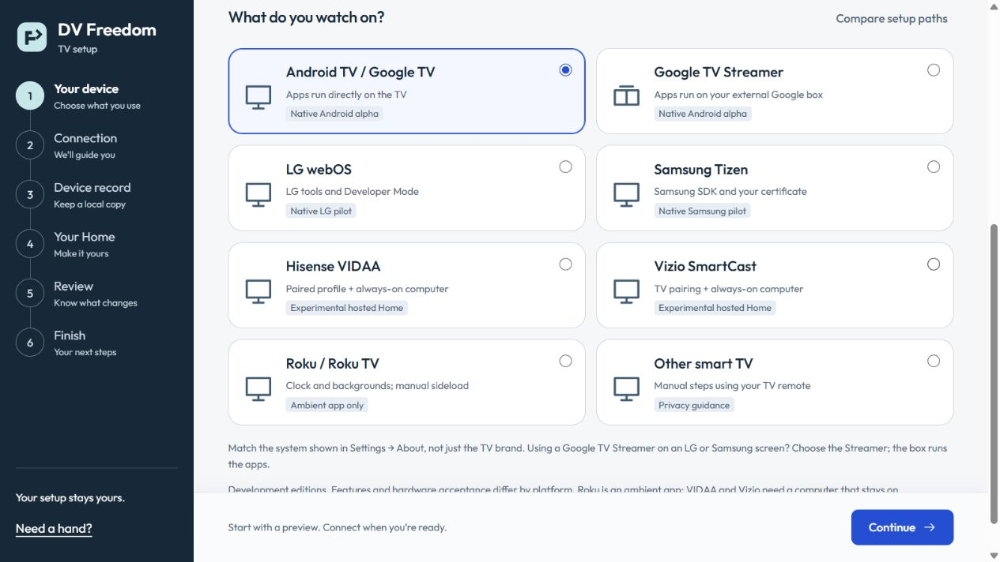
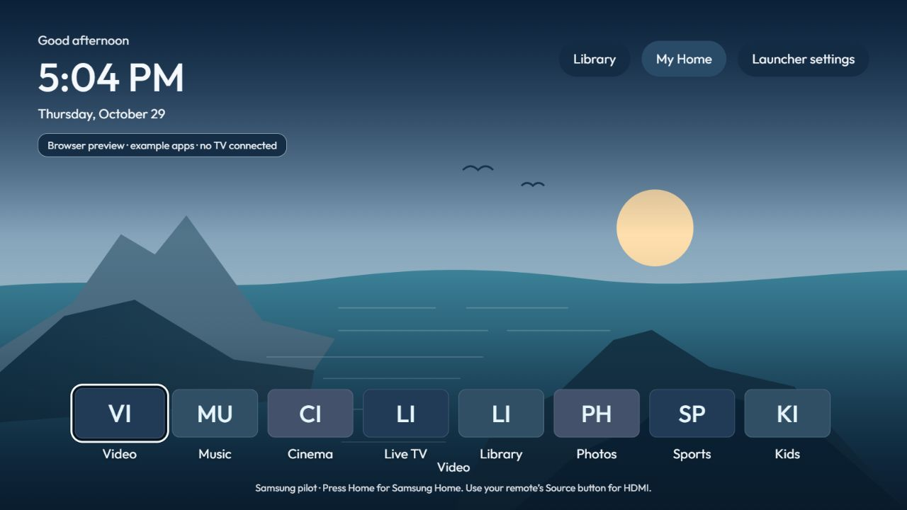
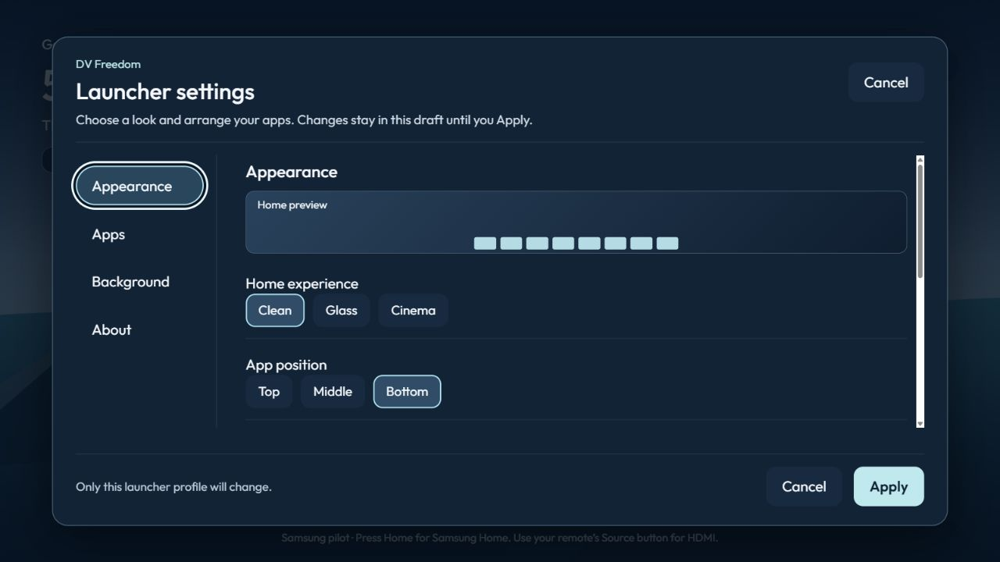

# DV Freedom Launcher

**Your TV. Your way.**

A personal TV Home with clear remote navigation, flexible app layouts, local profiles and optional
silent live wallpapers. Developed by DVOpenLabs, independently derived from
[CleanYourTV](https://github.com/Gathin23/cleanyourtv), with its history and MIT attribution retained.

**Development status:** Android alpha 20; LG/Samsung native pilots; experimental VIDAA/Vizio hosted
editions; Roku ambient app. These have different capabilities and testing limits. There is no public
Windows installer or general production binary release yet.

**Latest update — 30 October 2026:** alpha 20 expands the searchable Add-on Centre, adds photo/art
ambient views, richer Discover filters and reviewed service links, child-friendly Homes, optional
colour-key volume presets and a foreground wake rule. A separate Android phone Setup app uses paired
TLS and the same signed TV release. Native LG/Samsung gain favourite-only views and picture framing.
Optional [Camera](launcher/camera/README.md) adds silent personal-stream viewing and a separately
authorized timed corner window. All new connections and restricted modes start off. See the guides for requirements and testing limits.

[Try Setup](#try-the-setup-gui) · [Platform comparison](#choose-your-platform) ·
[Feature guide](product/ANDROID-COMMUNITY.md) ·
[Report feedback](https://github.com/DVOpenLabs/dv-freedom-launcher/issues/new/choose)

## One setup, a clear path for each device



*Actual Setup GUI, captured with a fresh demo session and no TV connection. Select the system that
runs your apps: a Google TV Streamer connected to an LG screen uses the Android path.*

Setup explains requirements before connection, shows a review before installation, and keeps the
original TV Home available. Android installation includes identity/signature checks, a private
recovery point and a timed new-profile preview. Native and hosted editions have their own review
steps and recovery limits; they do not inherit Android installation guarantees.

## Choose your platform

| System | What you can try now | Requirements and limits |
| --- | --- | --- |
| **Android TV / Google TV** | Native launcher and optional companion apps. | Android 8+ for the full product. Authorized debugging for setup. This alpha is not certified for every device or firmware. [Android guide](product/ANDROID-COMMUNITY.md). |
| **LG webOS** | Separate manual-launch Home app and guided first-install/helper preparation. | LG developer tools and Developer Mode. Source, packaging and mock checks; physical LG acceptance pending. No automatic LG Home takeover. [Native setup](setup_app/NATIVE-SETUP.md). |
| **Samsung Tizen** | Manual-launch pilot with app discovery, local profiles, layouts and silent media. | Samsung SDK, Developer Mode and your signing certificate. Source/browser/mock checked; signing and physical TV acceptance pending. No Home override or automatic startup. [Samsung guide](platforms/tizen/README.md). |
| **Hisense VIDAA** | Experimental hosted Home and guided app selection. | Existing authorized MQTT profile and a computer that stays on. Vendor debug-tile installation is manual; fresh pairing is not provided. Hardware acceptance pending. [Hosted guide](platforms/hosted/README.md). |
| **Vizio SmartCast** | Experimental hosted Home using normal pairing and Conjure. | Trusted certificate, TV PIN pairing, captured app IDs and a computer that stays on. Firmware may decline the route. No root or privileged webview; hardware acceptance pending. [Hosted guide](platforms/hosted/README.md). |
| **Roku / Roku TV** | DV Freedom Ambient: clock/background app source and ZIP builder. | Official manual developer sideload. No streaming-app launcher, HDMI control or Roku Home replacement. Hardware acceptance pending. [Roku guide](platforms/roku/README.md). |
| **Other smart TV** | Guided manual privacy instructions. | Changes are made using the TV remote; no native DV Freedom installation. |

All paths are in **one Setup GUI**. Platform support does not mean Android feature parity or certified
compatibility. Read the [complete setup comparison](setup_app/ALL-PLATFORMS.md) before connecting.

## Make Android Home your own

- **Four experiences:** Classic, Clean, Glass and Cinema, with timed preview and Keep/Revert.
- **Flexible apps:** top, middle or bottom placement; Small/Medium/Large icons; spacing, ordering,
  category rows, carousel options and app-name/artwork controls.
- **Readable settings:** Simple/All settings views over the same saved choices, seven sections, search,
  contextual help, consistent focus and previews. New navigation/feature labels have 29 locale resources;
  detailed new help currently falls back to English and still needs native-language acceptance.
- **Folders:** profile-owned groups with four-app mosaic covers, membership/order editing, edit locks,
  backup/restore and original app order retained. Updates never group your apps automatically.
- **App-browser exclusions:** profile-specific choices for All apps, app search and phone setup.
  Existing Home shortcuts and folder memberships remain saved; no Android package is disabled.
- **Startup choices:** choose one app and an optional wait for validated internet, up to ten minutes.
  Applies across profiles, once per device boot; leaving Home cancels the wait. Off until configured.
- **App links and remote rules:** optional links stay scoped to the selected app, with an app-open
  fallback. Ignore accidental app-button codes while retaining navigation, volume, power and Input.
  Remote rules require an already enabled key helper; no Accessibility grant is automatic.
- **Control Center:** choose favorite device shortcuts and browse a shared CEC-aware input list.
  Device/OEM availability varies; a Streamer cannot enumerate the connected television’s HDMI inputs.
- **Wallpaper Studio:** select local/USB files or a folder, preview fit/fill/focal point, then add to the
  library without selecting the item. Optional Immich/WebDAV sources live in Companions and refresh
  on request or, separately enabled, every 30 minutes while ambient is visible.
  [Photo & Art ambient](product/ANDROID-COMPANION.md#photo--art-ambient) adds portrait pairs, mats, captions
  and explicitly downloaded credited public-domain museum art. File-picker availability and URI access depend on the TV.
- **Optional Discover:** TMDB catalogue, genre/rating/sort/service/region filters, browse pages and
  a TV-local watchlist. Optional manually saved HTTPS title links stay scoped to the selected service. Bring your own
  read key. Availability is advisory; installed services offer search or app-open fallbacks, not guaranteed
  direct playback. No private streaming history is read.
- **Local backgrounds:** still images or silent video, still fallback and rotating wallpaper playlists.
  Optional scene schedules change the displayed background while Home is visible. Media pauses/releases
  resources away from Home.
- **Personal Homes:** local profiles, avatars, layout edit locks and saved restore points. Optional
  [Family Homes](product/ANDROID-PROFILES.md#family-homes) add an app allowlist and parent approval;
  a separate Accessibility guard is an additional opt-in, not secure parental control.
  An edit PIN protects launcher edits; it is not a streaming-account or system security boundary.
- **Optional weather:** the separate companion shows current conditions and a forecast, with editable
  temperature units and forecast details. The public source now includes an opt-in local bridge for Home
  and screensaver readings, including °F / °C together. Install Weather 1.1 separately, choose a city
  and explicitly approve your launcher in Weather settings. Sharing starts off; real-device acceptance
  of this new public bridge is pending. Network access belongs to the companion.
- **Optional content shelves:** Watch Next progress and Preview Programs that apps choose to share,
  with explicit TV-listings permission, source filters, 1/2/4 titles per app, bounded poster art and
  app-specific links. Hold OK for details. Empty shelves disappear. Optional HTTPS posters belong to
  the separate companion, start off and use a bounded cache; Home has no network permission.
- **Optional Now Playing:** an app-aware Home status and supported media controls. Requires a separate
  Android Notification access choice and profile opt-in. Notification text is ignored; media-session
  listeners run only while Home or the player panel is visible. No history or upload.
- **Native Android phone Setup:** a [separate Android 10+ app](mobile/README.md) for TVs with
  pairing-code Wireless debugging. Signed TV APK, peer confirmation, phone-lock approval and a timed
  TV profile preview; original Home stays selected. Legacy ADB and native LG/Samsung use desktop.
- **Phone-assisted setup:** explicitly start a temporary paired phone session from Setup. Send a draft
  or a picture/short MP4 to the computer; review before any TV change. Wallpaper import adds a library
  item and never selects it automatically. The trusted-network HTTP session expires after 15 minutes.
- **Add-on Center:** search 48 curated apps and references, with 19 signed package definitions,
  clear requirements and explicit connected-TV status checks. [See the package guide](product/ADDONS.md)
  for included tools and separate-project limits. Review each signed offline package before installing. Signer/downgrade checks and private recovery
  records protect updates; optional grants and connections are separate.
  Diagnostic/Bluetooth/ambient tools stay in All apps and Optional TV tools until explicitly added to Home.
- **Home & calendar companion:** optional Home Assistant favorites and scenes, family iCalendar events
  and Game Day countdowns. No server or feed is bundled. Credentials stay private in the companion;
  Home calendar visibility is a separate profile choice. No live scores.
- **TV-hosted phone remote:** optional PIN-paired local controls and focused-field keyboard without a
  running PC. Broad Android Accessibility access is separate; Android 11/12 D-pad support is limited.
  The server starts off, never starts at boot and can be stopped to revoke the phone. Optional phone setup
  needs two further choices: sharing in the launcher profile and setup/uploads for that server session.
  Drafts expire after two minutes and require native review/Apply. Artwork imports never select a wallpaper.
- **Setup help and AI drafts:** guided choices, draft-only Everyday/Big & clear/Movie night presets,
  and an offline appearance vocabulary such as “larger labels, apps at the bottom”. Optional Gemini
  drafting uses your key/model in Companions, shows the text and possible cost before every request,
  and still requires native validation/review/Apply. No bundled model or automatic paid call.

The launcher itself has no INTERNET permission or telemetry. Network providers and companions are
separate opt-ins. Feature details and prerequisites are in the [Android guide](product/ANDROID-COMMUNITY.md).
Optional add-ons are built separately rather than silently installed together. Setup’s **Explore optional
extras** directory explains platform and permission requirements before linking to a project. **Setup
health & support** downloads an allowlisted report without private addresses, paths or app inventories.

To install a companion, use the desktop Setup **Add-on Center** after connecting to an Android TV.
On the TV, **Launcher settings → Apps & rows → Add-on Center** opens installed companions. Calendar
sharing, **Calendar on Home**, poster downloads and Phone Remote Accessibility/server access are
separate choices; installing a package does not enable them.

## A look at the web pilot



*Samsung web pilot running in a desktop browser: example apps and original repository artwork.
This is a renderer preview, not an Android screenshot or proof of TV compatibility.*



*The same web pilot's Appearance draft. Android has its own native settings implementation and
additional features; the platform editions do not have identical menus.*

## Try the Setup GUI

For source testing, use **Python 3.12** and Git. No TV is needed to explore the example journey.

```sh
git clone https://github.com/DVOpenLabs/dv-freedom-launcher.git
cd dv-freedom-launcher
python -m venv .venv
```

Activate the environment on Windows PowerShell:

```powershell
.venv\Scripts\Activate.ps1
```

Or on macOS/Linux:

```sh
. .venv/bin/activate
```

Then run:

```sh
python -m pip install -r setup_app/requirements.txt
python -m setup_app.main
```

The GUI opens on a local loopback address. Native SDK prerequisites are explained for the selected
platform. The primary packaged target is Windows; other desktop environments need their own validation.

**A source checkout does not include the verified Android release bundle.** The example journey and
read-only checks work without it; Android installation remains unavailable until a valid signed
bundle is supplied. Developers can follow the [build/signing instructions](setup_app/README.md).
The existing Windows EXE is an unsigned private test alpha, not a GitHub download.

Local records, keys and recovery folders stay private. See [Setup behavior and recovery](setup_app/README.md)
and [installer prerequisites](setup_app/README.md). Closing only the browser tab leaves the
local setup process running; use **Need a hand? → Close setup app** to stop it.

## Build Android from source

Use JDK 17, Android SDK platform 34, build-tools 34.0.0 and the included Gradle wrapper.

```sh
cd launcher
./gradlew --no-daemon -PcommunityFeatures=true testReleaseUnitTest lintRelease assembleRelease
```

On Windows use `gradlew.bat`. Run `clean` when switching full/reference source sets.
`communityFeatures=true` selects DV Freedom; omitting it builds the inherited reference variant.
The reference keeps its **589,824-byte ceiling**; the full product is measured separately.

Full builds default to `com.dvopenlabs.freedomlauncher`. Normal source builds use development signing;
installer bundles require separately managed release signing. Existing pilot identities and keys are
not included. Check identity, certificate and backup before installing over an existing app:
[release identity and recovery policy](product/RELEASE-IDENTITY.md).

## Alpha limitations

This is a development alpha, not a general production release. Model-specific remote keys, HDMI/CEC,
streaming playback, file-picker support and private-service integrations need testing on the actual
device. A browser preview or successful app launch does not establish TV compatibility or playback.
Expanded settings help still has English fallbacks. Native LG/Samsung and hosted/ambient editions
have separate runtime and hardware limitations; see their platform guides above.

Build and regression-test instructions are in [CONTRIBUTING](CONTRIBUTING.md). Personal device reports,
internal research, work plans, debug captures and test-session logs remain local and are not publication
inputs. Share a redacted issue report when reporting a reproducible product problem.

## Find your way around

| Location | Purpose |
| --- | --- |
| [launcher/](launcher/) | Android full and reference source sets |
| [setup_app/](setup_app/) | Unified desktop setup GUI, checks, installation and recovery |
| [platforms/webos/](platforms/webos/) · [platforms/tizen/](platforms/tizen/) | Separate native LG/Samsung web apps and packaging |
| [platforms/hosted/](platforms/hosted/) · [platforms/roku/](platforms/roku/) | Hosted VIDAA/Vizio adapters and Roku ambient source |
| [platforms/shared-web/](platforms/shared-web/) | Portable local-profile and silent-media policies |
| [product/](product/README.md) | Feature guides, release contracts and source attribution |
| [addons/](addons/README.md) · [themes/](themes/README.md) | Optional companion source and attributed theme resources |
| [docs/](docs/) | Recovery/reference guides, specifications and UI screenshots |
| [tools/](tools/) · [tests/](tests/) | Command-line utilities and automated behavior/safety checks |

CleanYourTV model lists and its fork showcase remain available in the
[upstream project](https://github.com/Gathin23/cleanyourtv). They are not DV Freedom installation inputs
or a hardware certification list.

## Contribute and credits

[Open an issue](https://github.com/DVOpenLabs/dv-freedom-launcher/issues/new/choose) with the version,
platform, model/firmware, reproduction steps and expected result. Say whether you tested a browser
preview or physical TV. Redact private data before attaching screenshots/logs.

Start with [CONTRIBUTING.md](CONTRIBUTING.md),
[third-party notices](THIRD_PARTY_NOTICES.md) and [source provenance](product/THIRD-PARTY.md).
Useful small fixes can still be proposed separately to CleanYourTV.

The original [MIT licence](LICENSE), font licences and integrated-source notices remain included.
Projectivy is a design/research reference; its proprietary code and artwork are not bundled. Personal
anime wallpapers and generated videos are not part of the source distribution. README screenshots
use only demo apps and the project's original coast illustration; [capture details](docs/screenshots/README.md).

DV Freedom is independent and is not an official CleanYourTV, Google, LG, Samsung, Apple, Roku or
Projectivy release. Required source and licence attribution remains included.

The optional native **Android phone Setup** under `mobile/` has a separate GPL-3.0-or-later licence
and dependency/source obligations. It is not linked into the MIT TV launcher or desktop Setup. See
[mobile licensing](mobile/README.md#licensing-and-corresponding-source) before redistributing its APK.
