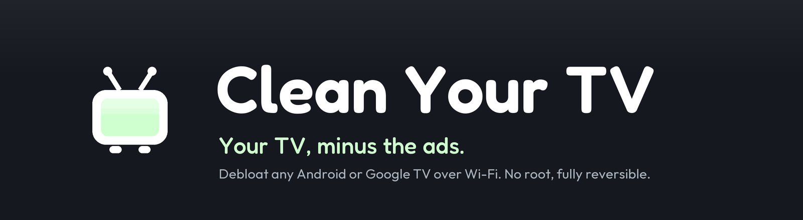
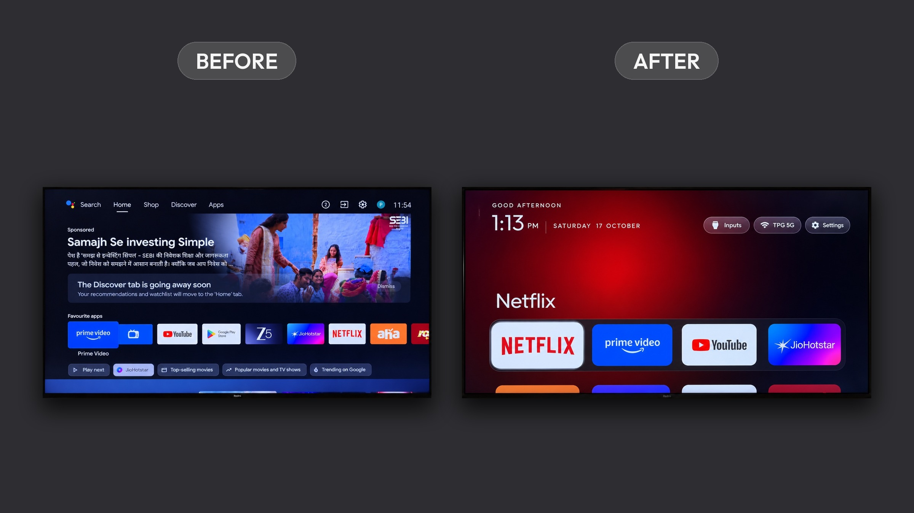

<p align="center">
  <a href="https://cleanyour.tv"></a>
</p>

<p align="center">
  <a href="README.md">English</a> · 简体中文
</p>

<p align="center">
  <a href="https://cleanyour.tv">项目网站</a> ·
  <a href="PROMPT.md">操作提示词</a> ·
  <a href="examples/README.md">机型清单</a> ·
  <a href="SHOWCASE.md">社区作品</a>
</p>

# CleanYourTV 中文使用指南

通过局域网连接 Android TV 或 Google TV，停用不需要的预装应用、广告和遥测服务，并安装简洁的原生桌面。无需 root、刷机或 USB 数据线；清理工具采用停用方式，不卸载系统应用，并提供恢复脚本。

本文介绍通用功能和使用方法。不同机型、地区和固件的应用包及限制可能不同，请先核对自己的设备。功能变化以[英文 README](README.md)为准，具体机型记录见[机型清单](examples/README.md)。



## 工作原理

电视开启开发者选项中的 USB 调试，并授权电脑后，就可以通过 Android 调试桥（ADB）完成以下步骤：

1. **备份**已安装应用列表及相关设置。
2. **按需停用**厂商遥测、广告服务、推荐内容和不需要的预装应用，使用的是 `pm disable-user`。
3. **安装简洁桌面**，并将其设为默认 HOME。

各品牌需要保留的系统组件不同。[操作提示词](PROMPT.md)会引导编程助手先检查实际设备，再确认你使用哪些应用和功能。

## 快速开始

准备一台与电视连接同一局域网的电脑，以及可以运行终端命令的编程助手，例如 Claude Code、Codex 或 Gemini CLI。

| 步骤 | 操作 |
|---|---|
| 1. 电视端 | 打开「设置 → 设备偏好设置 → 关于」，在「版本号 / Build」上连续按七次确定，返回后进入开发者选项，开启 USB 调试。如果另有网络调试或 ADB 调试开关，也需要开启。菜单名称因机型而异。 |
| 2. 电脑端 | 将 [`PROMPT.md`](PROMPT.md) 的内容交给助手，填写电视型号。 |
| 3. 确认需求 | 在电视上接受调试授权，告诉助手常用应用、底部快捷栏中的应用，以及是否保留语音助手、Chromecast 和系统更新。 |
| 4. 检查结果 | 按提示完成备份、清理和安装，检查应用启动、遥控器操作、输入源和恢复路径。 |

## 桌面功能

- **简洁首页**：深色背景，默认四个常用应用组成底部快捷栏。
- **应用聚焦展示**：显示当前应用名称及从图标提取的环境色。
- **应用网格**：按向下键进入更多应用，支持每行 4、5、6 或 7 个。
- **动效控制**：可开关动态效果，也可单独启用高级动态效果。
- **常用入口**：输入源（HDMI、AV、直播电视）、Wi-Fi / 以太网和系统设置。
- **时钟与屏保**：问候语、时间、日期，以及配套的时钟屏保。
- **主题**：通过配置文件调整颜色、壁纸、快捷栏和列数，无需重新编译。
- **模块卡片**：其他应用可以提供桌面卡片，需用户同意才会显示。


### 在电视上调整设置

短按桌面的「设置」按钮进入电视系统设置；**在该按钮上长按遥控器确定键**，选择「简洁桌面设置」，可以调整：

| 选项 | 作用 |
|---|---|
| 每行应用数量 | 选择 4、5、6 或 7 个，列数增加时卡片相应缩小。 |
| 动态效果 | 开启或关闭桌面动画。 |
| 高级动态效果 | 增加卡片上浮、图标缩放和背景颜色平滑过渡。可能增加内存占用，实际影响取决于电视。 |
| 跟随主题（重置电视端设置） | 清除电视端的布局与动效选择，恢复当前主题或内置配置。推送或重置主题也会清除这些选择。 |
| 默认桌面入口 | 打开 Android 的默认桌面选择页，切换到原始桌面或 CleanYourTV。 |

默认桌面入口不负责重新启用已停用的原始桌面。如果原始桌面已被安装脚本停用，需要先按下文恢复。部分电视不提供系统桌面选择页。还可以通过 `show_home_settings_shortcut` 配置单独显示该入口。

## 支持哪些设备

本项目面向 **Android TV / Google TV**，已有社区提供的多种电视与电视盒子配置。请在[机型清单](examples/README.md)中核对型号、地区和固件，阅读对应目录的说明，再使用停用列表。

- Samsung Tizen 和 LG webOS 不能直接运行本项目的 Android 桌面；社区移植项目可参考[社区作品](SHOWCASE.md)。
- Fire TV 可以参考清理部分，但 Fire OS 对替换默认桌面有限制。
- 部分中国大陆版 TCL 固件限制第三方桌面安装，不能仅凭品牌判断兼容性。
- 没有现成清单时，可以让助手检查实际设备，并按[贡献指南](CONTRIBUTING.md)提交经过验证的机型记录。

## 手动操作

以下命令从仓库根目录运行。`192.168.1.50` 是示例地址，请替换为电视的局域网地址。

### 1. 准备连接工具

连接工具需要 Python 3：

```bash
python3 -m venv tools/venv
tools/venv/bin/pip install -r tools/requirements.txt
export TV_HOST=192.168.1.50

# 读取型号、Android 版本和固件
tools/venv/bin/python -I tools/tv.py --probe

# 查看已安装的应用包
tools/venv/bin/python -I tools/tv.py 'pm list packages'
```

### 2. 按需应用停用列表

**下面的小米路径仅为示例，请替换为与你的电视匹配且已核对的列表。** 不要将其他机型的列表直接用于自己的电视。

```bash
tools/disable.sh examples/xiaomi-mi-tv-4a/debloat.txt
```

列表路径相对于运行命令时所在的目录，也可以使用绝对路径。保留原列表及工具生成的恢复记录，方便撤销。

### 3. 编译和安装桌面

桌面使用 Java 和 AndroidX RecyclerView，应用包名为 `com.gathin.tvhome`。编译需要 JDK 17、Android SDK Platform 34 和 Build Tools 34.0.0。macOS 可安装：

```bash
brew install openjdk@17 android-commandlinetools
sdkmanager "platforms;android-34" "build-tools;34.0.0"
```

Linux 安装脚本可查找 `~/Android/Sdk` 和 `PATH` 中的 Java。准备好环境后运行：

```bash
TV_HOST=192.168.1.50 launcher/build-and-install.sh
```

**此脚本不仅安装 APK，还会切换默认 HOME，并按检测结果停用原始桌面。** 它先确认新桌面能够启动，再完成切换；切换失败时尝试回退。

可使用 `STOCK_LAUNCHER=<包名>` 指定原始桌面；如果希望保留原始桌面的启用状态，使用：

```bash
TV_HOST=192.168.1.50 STOCK_LAUNCHER=none launcher/build-and-install.sh
```

`none` 只表示不停用原始桌面，**仍会将 CleanYourTV 设为默认 HOME**。

### Windows

仓库提供对应的 PowerShell 脚本。安装 Python 和 Android Studio，并确认上述 JDK、SDK 组件可用后：

```powershell
python -m venv tools\venv
tools\venv\Scripts\python.exe -m pip install -r tools\requirements.txt
powershell -ExecutionPolicy Bypass -File launcher\build-and-install.ps1 -TvHost 192.168.1.50
```

PowerShell 安装脚本使用 `-StockLauncher <包名>` 指定原始桌面，或使用 `-StockLauncher none` 保留其启用状态。清理与恢复分别使用 [`tools/disable.ps1`](tools/disable.ps1) 和 [`tools/restore.ps1`](tools/restore.ps1)。

### 工具索引

| 工具 | 用途 |
|---|---|
| [`tools/tv.py`](tools/tv.py) | Python ADB 客户端，支持执行命令、批处理、上传和下载。 |
| [`tools/b64push.py`](tools/b64push.py) | 分块上传 APK 等大文件并校验。 |
| [`tools/disable.sh`](tools/disable.sh) / [`tools/restore.sh`](tools/restore.sh) | 应用停用列表，或按照操作前记录恢复。 |
| [`tools/recovery.py`](tools/recovery.py) | 保存恢复记录并生成恢复命令。 |
| [`tools/theme.sh`](tools/theme.sh) | 推送或重置主题，并重新启动桌面。 |
| [`launcher/build-and-install.sh`](launcher/build-and-install.sh) | 编译、安装桌面并切换 HOME。 |

## 更多配置

### 布局与主题

内置配置位于 [`config.xml`](launcher/app/src/main/res/values/config.xml)，可设置快捷栏顺序、隐藏应用、直播电视包名、列数、快捷栏下方的行数、网络按钮关联的 VPN 应用，以及 `reduced_motion` 等选项。

主题通过 `config.json` 覆盖内置配置，还可提供背景色和壁纸。使用示例：

```bash
TV_HOST=192.168.1.50 tools/theme.sh themes/aurora
```

恢复内置主题：

```bash
TV_HOST=192.168.1.50 tools/theme.sh --reset
```

主题格式和可用配置见 [`themes/README.md`](themes/README.md)。

### 语言、屏保与遥控器

- **语言**随电视系统切换，包括简体中文和繁体中文。Android 13 及以上也支持单独设置应用语言，例如：`tools/tv.py 'cmd locale set-app-locales com.gathin.tvhome --locales zh-CN'`。
- **时钟屏保**可在电视的屏保设置中选择 Clock；也可执行：`tools/tv.py 'settings put secure screensaver_components com.gathin.tvhome/.ClockDream; settings put secure screensaver_enabled 1'`。
- **输入源键**可通过安装时的 `INPUT_KEY_SERVICE=1` 启用辅助功能服务，以适配 Google TV 的遥控器输入源按钮。
- **HOME / 设置键**可通过 `HOME_KEY_SERVICE=1` 及 `config.xml` 中的按键配置适配部分设备。`settings_key_panel` 可启用快捷设置面板，提供电视设置、显示、网络、应用和桌面设置入口。

### 模块卡片

应用可声明自己的卡片名称、说明和环境色。桌面会询问是否显示，默认保持隐藏，并按应用签名及卡片名称保存选择。在桌面「设置」按钮上长按确定，选择模块卡片菜单即可管理。

开发说明见 [`docs/modules.md`](docs/modules.md)，接口约定见 [`docs/specs/card.md`](docs/specs/card.md)。

## 恢复原始桌面和应用

`tools/disable.sh` 在停用前记录列表内各应用的状态（启用、已停用或未安装）、当时的默认 HOME 和三项系统动画缩放设置。记录位于电脑的 `~/.cleanyourtv/`，按电视和列表分别保存。重复运行同一列表不会覆盖最初记录；新增列表项会补充记录。

将以下路径替换为**实际使用过的列表**后恢复：

```bash
TV_HOST=192.168.1.50 tools/restore.sh examples/xiaomi-mi-tv-4a/debloat.txt
```

如需指定原始桌面的备用包名，可增加最后一个参数。Google TV 常用的是 `com.google.android.apps.tv.launcherx`，但应以实际设备为准：

```bash
TV_HOST=192.168.1.50 tools/restore.sh "examples/你的机型/debloat.txt" com.google.android.apps.tv.launcherx
```

- 有记录时，优先恢复当时实际拥有 HOME 的组件；备用包名用于当时没有解析到 HOME 或 HOME 已属于 CleanYourTV 的情况。
- 操作前已经停用的应用会保持停用，避免把原本不需要的服务全部打开。
- 缺少记录时，脚本会提示并回退为启用列表内应用、将动画缩放恢复为 `1.0`；这不等同于精确恢复操作前状态。
- 恢复脚本不会卸载 CleanYourTV，也无法恢复列表之外的手动修改。若要卸载，可在电视「设置 → 应用」中操作。
- 无法连接 ADB 时，也可以尝试从电视系统设置中重新启用相关应用。

## 故障排查

完整说明见 [`docs/TROUBLESHOOTING.md`](docs/TROUBLESHOOTING.md)。

- **macOS 提示 `No route to host`**：检查本地网络隐私权限；可尝试仓库的 Python ADB 工具 `tools/tv.py`。
- **替换后 HOME 异常**：应先确认新桌面已安装且能够运行，再停用原始桌面。安装脚本按这个顺序执行。
- **Google TV 设置向导抢占 HOME**：`com.google.android.tungsten.setupwraith` 可能在原始桌面停用后抢占 HOME。先按故障排查文档检查它是否拥有当前 Wi-Fi 配置；直接停用可能删除该网络。清理工具会在这种情况下跳过它，需先从系统设置重新连接网络。若已经异常，可尝试重新启用 Google TV 原始桌面：`tools/tv.py 'pm enable --user 0 com.google.android.apps.tv.launcherx'`。

## 常见问题

**会刷机或删除系统应用吗？**

不会。清理通过停用应用实现，但停用系统依赖仍可能造成故障，因此需要按机型核对、分批处理，并保留恢复路径。

**系统更新和应用更新会受影响吗？**

部分停用列表包含系统更新服务，需要重新启用后才能接收固件更新。常用流媒体应用仍可通过保留的应用商店更新；具体取决于设备和所用列表。

**能远程帮助其他人操作吗？**

可以通过私有 Tailscale 网络连接，详见[远程操作说明](docs/REMOTE.md)。不要在路由器上将 ADB 端口暴露到互联网。

**完成后要关闭调试吗？**

需要。网络 ADB 使用明文连接，部分固件甚至不强制授权。完成后关闭 USB 调试及网络 / ADB 调试，撤销调试授权，并按[英文 README 的检查步骤](README.md#questions-people-ask)确认端口已关闭。

**支持私有 DNS 或 AirPlay 吗？**

私有 DNS 是部分 Android 版本提供的系统功能，并非桌面的广告过滤能力，也无法屏蔽所有视频广告。AirPlay 不属于桌面内置功能，需要另行安装和配置。相关可选方案见[英文常见问题](README.md#questions-people-ask)。

**有现成 APK 吗？**

目前仓库的使用方式是通过安装脚本编译并安装，方便根据设备调整配置。

## 参与贡献

欢迎提交经过实际设备验证的机型清单、桌面改进、文档修正和主题。提交前请阅读 [`CONTRIBUTING.md`](CONTRIBUTING.md)，每个 PR 保持一个主题，并说明验证范围。衍生项目和不同风格的桌面可登记在 [`SHOWCASE.md`](SHOWCASE.md)。

如果英文说明发生变化，也欢迎同步修订本文。机型数量、支持列表和主题列表直接参考对应目录，以减少重复维护。

## 许可证

项目采用 [MIT 许可证](LICENSE)。Outfit 字体采用 [SIL Open Font License](launcher/FONT-LICENSE-OFL.txt)。
